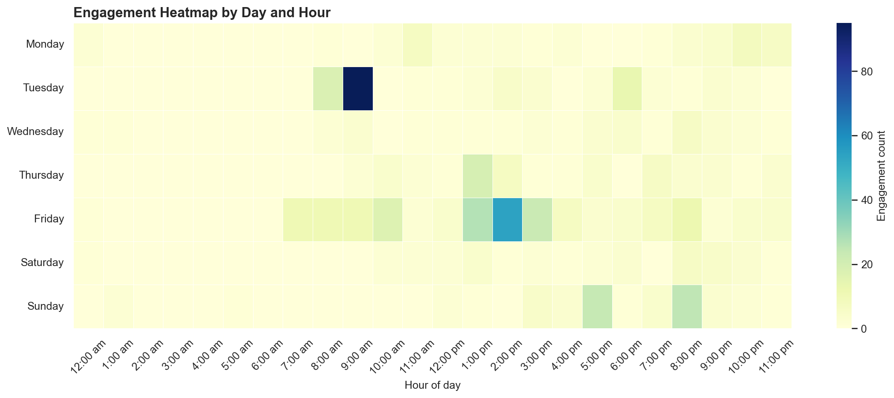

# SP DAAA IDM CA2 Audience Engagement Analysis

[](https://github.com/fishman7337/sp-daaa-idm-ca2-audience-engagement-analysis/actions/workflows/ci.yml)

Python and Jupyter analysis project for a Singapore Polytechnic Introduction to Digital Marketing CA2 assignment. The repository studies audience engagement patterns from post-level data, including comments, reactions, views, day-of-week activity, time-of-day activity, and selected-post performance against the wider observed population.

## Evidence and interpretation

| Evidence-backed measure | Current repository evidence |
| --- | --- |
| Parsed corpus | **100 posts, 192 comments, 689 reactions, and 8,208 views**. |
| Campaign subset | **7 selected content pieces** are analysed as the focused campaign group. |

The qualitative outcome is an evidence-led content-performance workflow spanning data quality, engagement comparisons, correlations, visualisation, and recommendations. Corpus totals describe the source data, not a post-recommendation uplift in engagement.

## Academic Context

This project was completed under Singapore Polytechnic, School of Business, Poly-Wide Elective, **Introduction to Digital Marketing (EP0702), CA2**, in **AY24/25 Year 1 Semester 2**.

Lecturer: **Adjunct Lecturer Yen Wong**

Team:

- Goh Kun Ming (DAAA)
- Phyo Yadana Khaing (DBKF)
- Nuha Syafeqah (DMAD)
- Jayden Lee Jia Jun (CBP)
- Law Yu Hang (DBA)
- Sia Xing Ying (DMAD)

## What This Project Does

The analysis answers practical digital marketing questions:

- Which posts received the strongest views, comments, and reactions?
- How does the selected group-post subset compare with the wider post population?
- Which days of the week show stronger engagement?
- Which hours of the day show concentrated audience activity?
- How do post type, post duration, and engagement metrics relate to each other?

The project includes both a polished notebook and a runnable Python script so the analysis can be reviewed interactively or reproduced from the command line.

## Key Outputs

Generated figures are stored in `reports/figures/`.

| Output | Purpose |
| --- | --- |
| `post_type_performance.png` | Compares selected-post performance by content type. |
| `views_reactions_scatter.png` | Shows the relationship between views, reactions, comments, and post type. |
| `day_of_week_engagement.png` | Summarizes combined engagement by weekday. |
| `daily_engagement_trend.png` | Tracks posts, comments, reactions, and active members over time. |
| `time_of_day_heatmap.png` | Highlights engagement concentration by day and hour. |
| `population_comparison_overview.png` | Compares selected posts against the wider observed population. |
| `comments_comparison.png`, `reactions_comparison.png`, `views_comparison.png` | Report-ready comparison figures for individual metrics. |

Preview:



## Repository Layout

```text
.
|-- .github/              GitHub Actions workflow documentation and CI.
|-- data/raw/             Original CSV datasets used by the notebook and tests.
|-- docs/                 Project background, methodology, data dictionary, and ethics notes.
|-- notebooks/            Cleaned Jupyter notebook and paired Python script.
|-- reports/figures/      Exported chart images.
|-- scripts/              Reproducible command-line utilities.
|-- src/                  Reusable Python package code.
`-- tests/                Pytest data quality, structure, and security hygiene checks.
```

Every project folder includes its own `README.md` explaining what belongs there.

## Quick Start

Clone the repository:

```powershell
git clone https://github.com/fishman7337/sp-daaa-idm-ca2-audience-engagement-analysis.git
cd sp-daaa-idm-ca2-audience-engagement-analysis
```

Create and activate a virtual environment:

```powershell
python -m venv .venv
.\.venv\Scripts\Activate.ps1
python -m pip install --upgrade pip
pip install -e ".[dev,notebook]"
```

Run the cleaned analysis script and regenerate the full figure set:

```powershell
python notebooks/engagement_analysis.py
```

Open the notebook:

```powershell
jupyter lab notebooks/engagement_analysis.ipynb
```

Regenerate only the three population comparison figures:

```powershell
python scripts/regenerate_figures.py
```

## Data

Raw data lives in `data/raw/`:

- `posts.csv`: post-level comments, reactions, views, member names, and source links.
- `days_summary.csv`: combined engagement by day of week.
- `daily_engagement.csv`: daily posts, comments, reactions, and active members.
- `time_of_day_engagement.csv`: engagement counts by weekday and hour.

See `docs/data-dictionary.md` for column definitions.

## Methodology

The analysis workflow is:

1. Load raw CSV files from `data/raw/`.
2. Validate required files, columns, date order, weekday order, and numeric fields.
3. Prepare the selected group-post subset using curated post date and type metadata.
4. Calculate engagement as `Comments + Reactions`.
5. Calculate engagement rate as `(Comments + Reactions) / Views * 100`.
6. Compare selected posts with the wider observed post population.
7. Export charts to `reports/figures/`.

See `docs/methodology.md` for assumptions and limitations.

## Development Checks

Run all tests:

```powershell
pytest
```

Run linting:

```powershell
ruff check src scripts tests notebooks/engagement_analysis.py
```

Run static security scanning:

```powershell
bandit -r src scripts -c pyproject.toml
```

Audit Python dependencies:

```powershell
pip-audit . --progress-spinner off
```

## CI and Security

GitHub Actions runs on pushes and pull requests:

- `ruff` linting.
- `pytest` tests.
- `bandit` static security scan.
- `pip-audit` dependency vulnerability scan.

The workflow is defined in `.github/workflows/ci.yml`.

## Privacy and Ethics

The dataset contains names, post text, engagement metrics, and post links. Treat it as academic project data. Review `docs/privacy-and-ethics.md` before sharing the repository or reusing the data outside its original class context.

No secrets are required for this project. `.env.example` is provided only as a template for future local configuration. Real `.env` files are ignored by git.

## License

This project is released under the MIT License. See `LICENSE`.
